# RNode User Guide

**Firmware 25.1.32.0** (build 123) · OpenWrt 25.12 · Bitcoin Core 32.1

RNode is a home internet router that is also a **Bitcoin full node**: it keeps
its own copy of the Bitcoin blockchain on a built-in drive and checks every
block and transaction itself. This guide covers everything RNode adds — first
setup, the node pages, Settings, updates, resets, the lights and buttons — on
the screens as they appear in this firmware.

It does not teach OpenWrt or Bitcoin Core themselves. Where a change can only
be made in the router's advanced pages (**Router settings**, OpenWrt's LuCI),
the guide gives the exact clicks.

> Screenshots are of firmware 25.1.32.0, in English. Numbers, names and addresses in them
> are examples. They are made with `contrib/guide-screenshots/capture.py`, so
> every release can refresh them.

---

## Contents

1. [The router at a glance](#1-the-router-at-a-glance)
2. [Before you start](#2-before-you-start)
3. [First-time Setup](#3-first-time-setup)
   - [3.1 Connect to the router](#31-connect-to-the-router)
   - [3.2 Step 1 — Welcome](#32-step-1--welcome)
   - [3.3 Step 2 — Security (secure connection)](#33-step-2--security-secure-connection)
   - [3.4 Step 3 — Choose Quick Start or Guided Setup](#34-step-3--choose-quick-start-or-guided-setup)
   - [3.5 Quick Start](#35-quick-start)
   - [3.6 Guided Setup](#36-guided-setup)
   - [3.7 Finishing: reconnecting to the new Wi-Fi](#37-finishing-reconnecting-to-the-new-wi-fi)
   - [3.8 If Setup is interrupted](#38-if-setup-is-interrupted)
4. [Node Status — the main page](#4-node-status--the-main-page)
5. [Node software](#5-node-software)
6. [Settings](#6-settings)
7. [Changing Wi-Fi, passwords and internet after Setup](#7-changing-wi-fi-passwords-and-internet-after-setup)
8. [Adding another computer (secure connection)](#8-adding-another-computer-secure-connection)
9. [Updating the firmware](#9-updating-the-firmware)
10. [Restarting, shutting down and power cuts](#10-restarting-shutting-down-and-power-cuts)
11. [Factory reset](#11-factory-reset)
12. [Lights and buttons](#12-lights-and-buttons)
13. [The blockchain drive (M.2)](#13-the-blockchain-drive-m2)
14. [Troubleshooting](#14-troubleshooting)
15. [Reference](#15-reference)

---

## 1. The router at a glance

### Ports

| Port | Use |
|------|-----|
| **WAN** (and **SFP-WAN**) | To your modem or wall internet socket |
| **LAN1, LAN2, LAN3** (and **SFP-LAN**) | Your computers and other wired devices |
| **Power** | The supplied power adapter |

Wi-Fi is built in: both radios broadcast the same network name (`rnode` until
you change it).

### The label (sticker)

Every router has its own label. **Keep it** — you need it for Setup, and again
after any factory reset.

| On the label | What it is for |
|--------------|----------------|
| **Join Wi-Fi rnode — Password** `xxxx-xxxx-xxxx` | The Wi-Fi password **and** the router login password until you finish Setup (and again after a factory reset) |
| **Setup opens by itself — if it does not, go to** `http://rnode-XXXX.local` **or** `http://192.168.1.254` | Where Setup is. `XXXX` is this router's own four-character code |
| **Router login: root / same password** | The username for Settings and Router settings |
| **MAC** | The router's hardware address (for support) |

The password uses only easy-to-read letters and numbers (no `0`, `o`, `1`, `l`
or `i`).

### Names you can use to reach the router

All of these open the same pages from a computer on the router's network:

| Address | Notes |
|---------|-------|
| `rnode-XXXX.local` | This router's own name, printed on the label. Always works, even with several RNodes on one network |
| `rnode.local` | Works when it is the only RNode on the network |
| `192.168.1.254` | The router's address (unless you changed it in Guided Setup) |
| `node-router` | Works on computers that use the router for DNS |

Some computers do not support `.local` names (some company laptops, VPNs,
Android). Use the address instead.

---

## 2. Before you start

- **Use a laptop or desktop computer** (Windows, Mac or Linux). Phones and
  tablets cannot run Setup — they only show *Please use a laptop or computer*
  (they can use the Wi-Fi normally afterwards):

  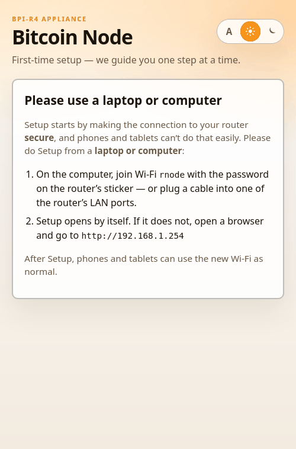

- Plug your modem into the **WAN** port and switch the router on. First start
  takes a few minutes.
- Have the **label** to hand.
- Decide on two new passwords:
  - a **router password** (8 characters or more) — for Settings and Router
    settings;
  - a **Wi-Fi password** (8–63 characters, letters, numbers and ordinary
    symbols) — for your phones and laptops.
  Neither may be the password on the label. Write them down.

---

## 3. First-time Setup

Setup takes about 10 minutes. It runs in your computer's web browser.

### 3.1 Connect to the router

Either:

- **Wi-Fi:** join the network **`rnode`** with the password on the label, or
- **Cable:** plug a network cable from the computer into a **LAN** port.

On Wi-Fi, Setup usually **opens by itself** (your computer shows "Sign in to
network"). If it does not, open a browser and go to the address on the label,
typed exactly: `http://rnode-XXXX.local` (or `http://192.168.1.254`).

> **Mac:** if Setup opened in the small "sign-in" window, open **Safari**,
> **Chrome** or **Firefox** and go to the address the page shows — the sign-in
> window cannot finish the Security step.

> Until Setup is finished, a few sites (Google, Apple) may not load — the
> router is pointing your computer at Setup. Finish Setup first.

### 3.2 Step 1 — Welcome

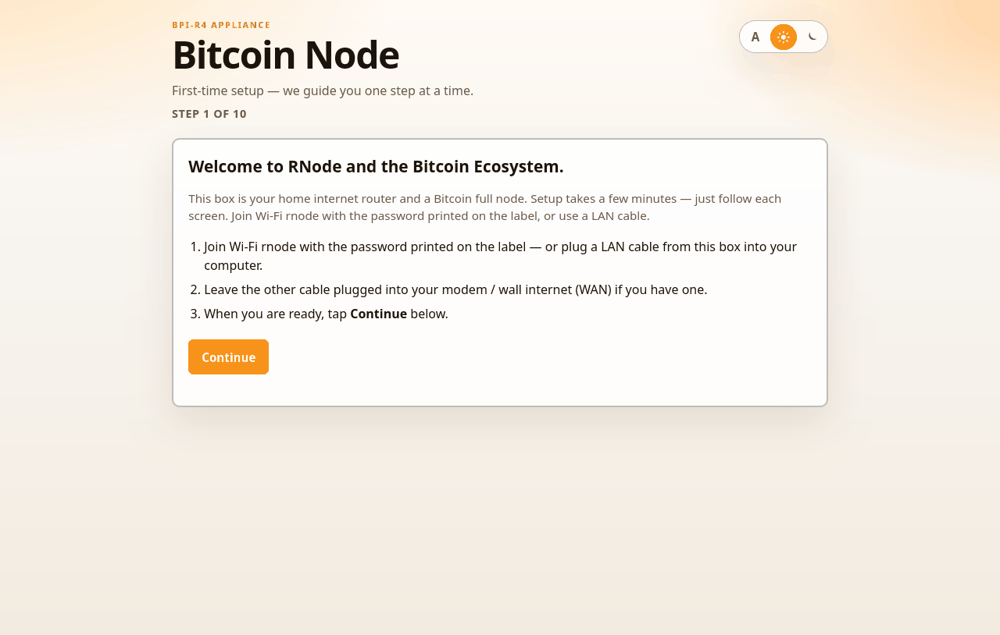

Check that the WAN cable is in, then click **Continue**.

### 3.3 Step 2 — Security (secure connection)

This step lets your computer trust the router, so every page after it uses a
**secure (HTTPS) connection** with no browser warnings. One small file does it
once per computer. The page shows the steps for your computer; another system
can be chosen under **Different operating system**.

The installer will ask for **your computer's password** — never the router's.
The web page itself never asks for a password.

#### Windows

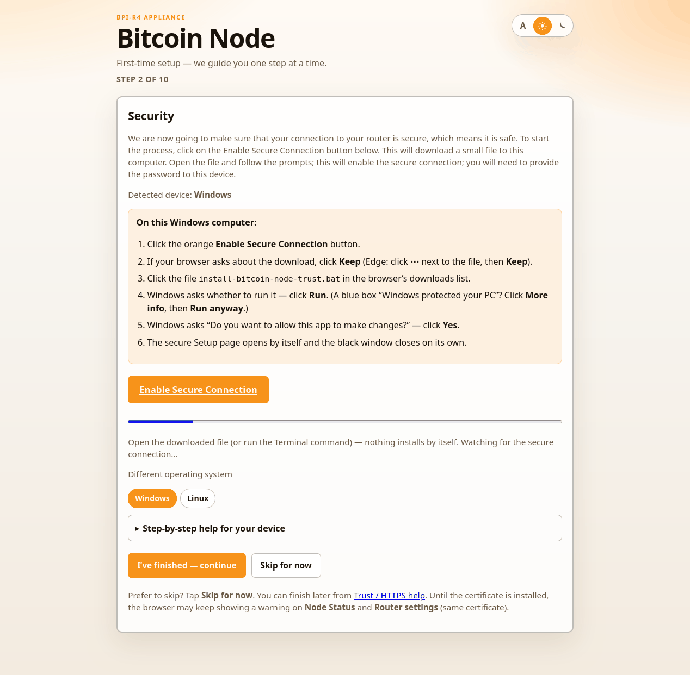

1. Click the orange **Enable Secure Connection**. A file
   `install-bitcoin-node-trust.bat` downloads.
2. If the browser asks, click **Keep** / **Save** / **Allow** (in Edge: **⋯**
   → **Keep**; in Firefox you must click **Allow** or the file never downloads).
3. Click the file in the browser's downloads list.
4. Click **Run**. If a blue box says *Windows protected your PC*, click
   **More info** → **Run anyway**.
5. When Windows asks *Do you want to allow this app to make changes?*, click
   **Yes**.
6. A black window appears and closes by itself; the secure Setup page opens.

#### Mac

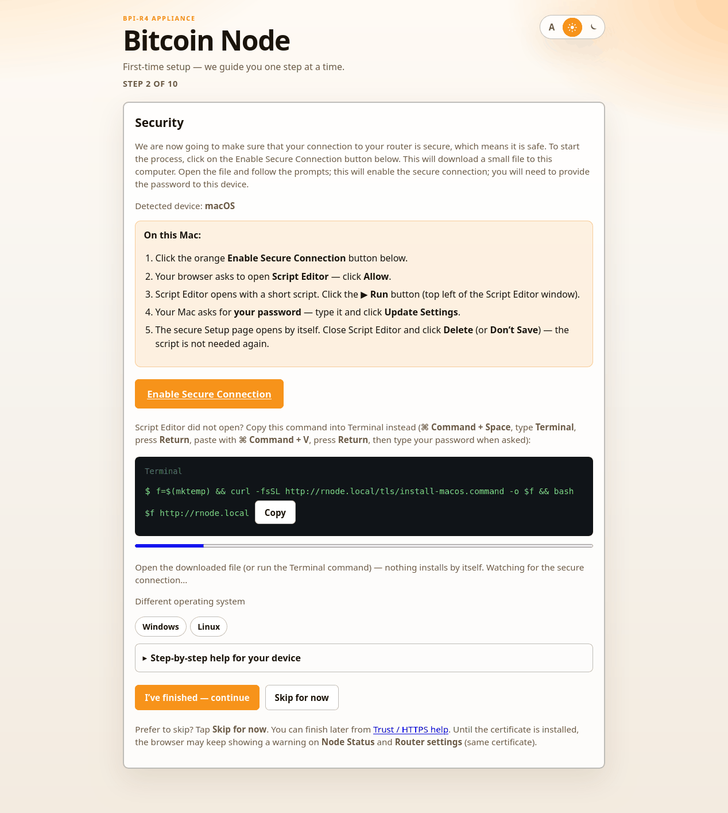

1. Click **Enable Secure Connection**. The browser asks to open **Script
   Editor** — click **Allow**.
2. In Script Editor click **▶ Run**.
3. Type **your Mac password** and click **Update Settings**.
4. Close Script Editor and choose **Delete** or **Don't Save**.

The page also offers a Terminal command with a **Copy** button, if you prefer.

#### Linux (Ubuntu, Debian, Mint)

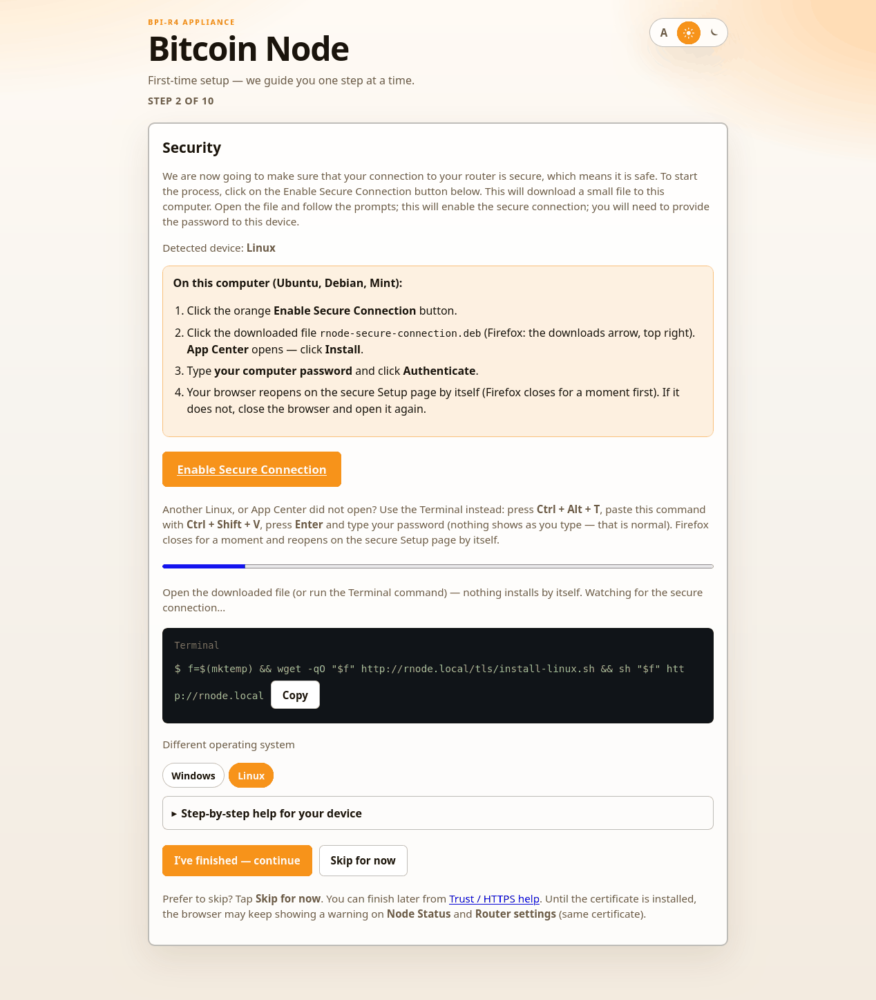

1. Click **Enable Secure Connection**; `rnode-secure-connection.deb`
   downloads.
2. Open it — **App Center** shows **Install**. Click it, type your computer
   password, click **Authenticate**.
3. Firefox closes for a moment and reopens on the secure Setup page.

Other Linux systems: press **Ctrl + Alt + T**, paste the command the page
shows, press **Enter** and type your password.

#### While you install

The page watches for the installer and shows its progress. When it sees the
secure connection it moves on **by itself** — you do not need to type an
address.

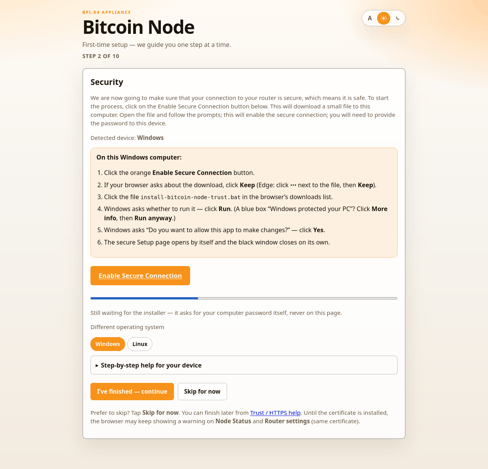

**Step-by-step help for your device** opens a longer version of the steps:

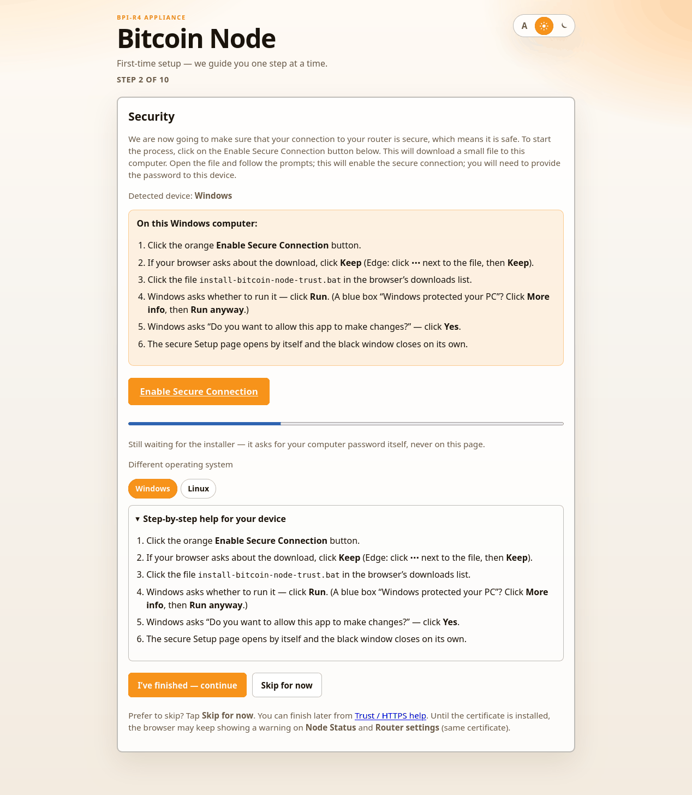

- **I've finished — continue** checks again by hand. If it still is not
  secure, close the browser completely, open it again and go back to the
  router.
- **Skip for now** carries on without it. Setup works, but the browser warns on
  every page until you do it (later, from `http://rnode.local/tls.html`).
- If nothing happens after about 5 minutes, the page says so: restart the
  browser if it was open during the install, or skip.

One install covers both the RNode pages and **Router settings**.

### 3.4 Step 3 — Choose Quick Start or Guided Setup

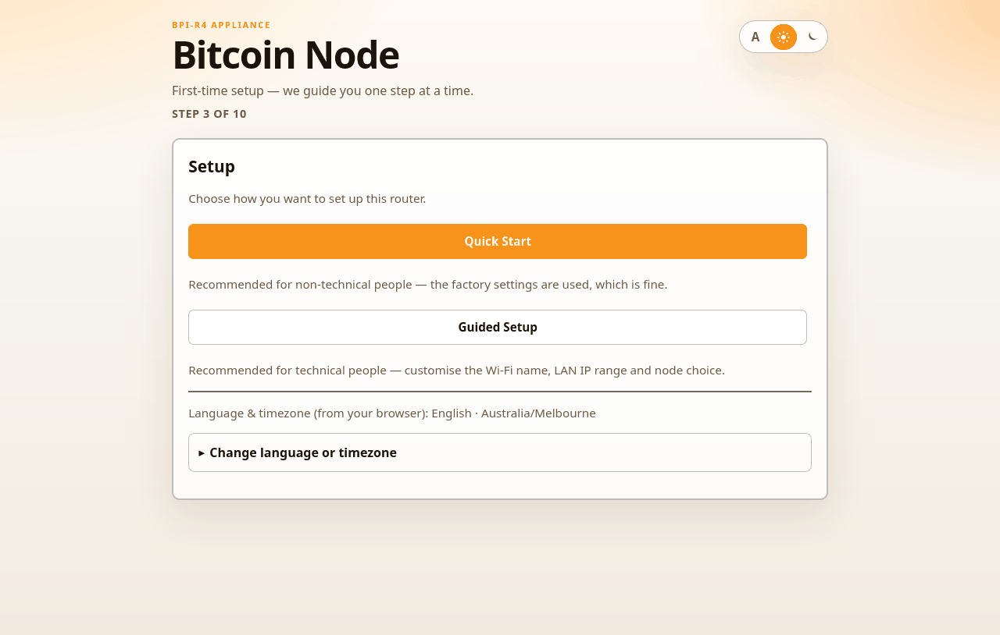

| | Who it is for | What you choose |
|---|---|---|
| **Quick Start** | Most people | Router password and Wi-Fi password. Everything else uses the factory defaults |
| **Guided Setup** | Technical users | Internet type, the router's address range, Wi-Fi name and password, router password |

**Language & timezone** are taken from your browser and shown under the
buttons. To change them, open **Change language or timezone**:

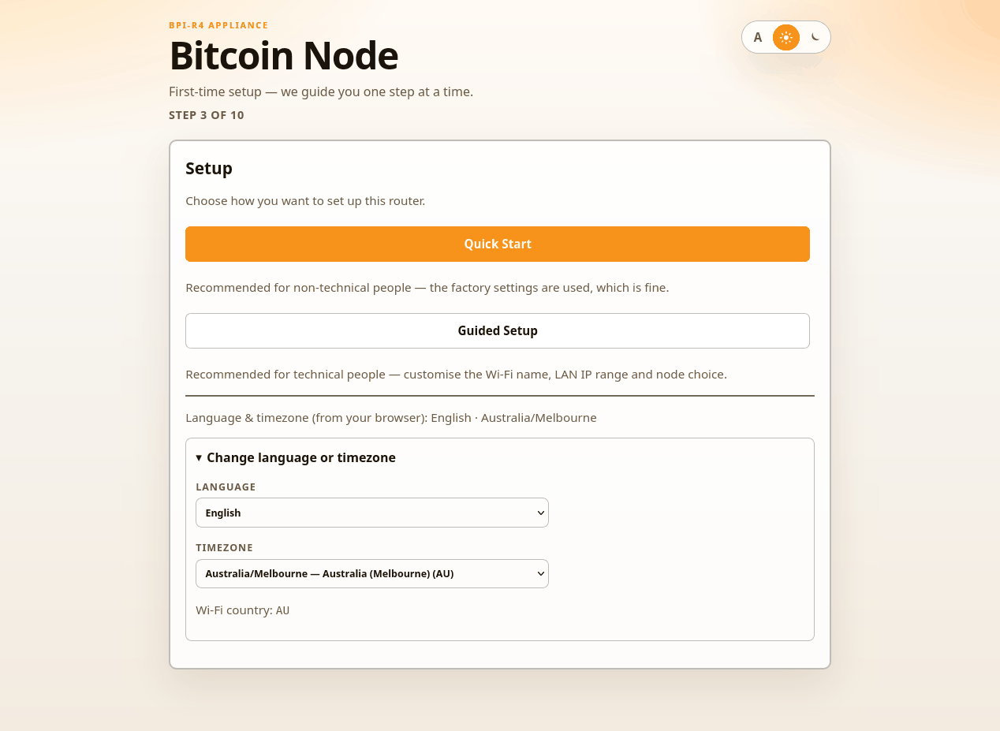

- **Language:** English, Español, Deutsch, Français, 简体中文, 日本語,
  Português (Brasil). The page changes language straight away.
- **Timezone:** sets the router's clock and the **Wi-Fi country** shown below
  it (which radio channels are allowed). If your browser's timezone is not in
  the list, Setup picks a listed one with the same time right now (in the same
  part of the world where possible), tells you so, and opens this control —
  check it and choose a better one if you like.

They are saved when you click Quick Start or Guided Setup. Every RNode page —
and Router settings — then uses that language. It can be changed later in
Settings.

### 3.5 Quick Start

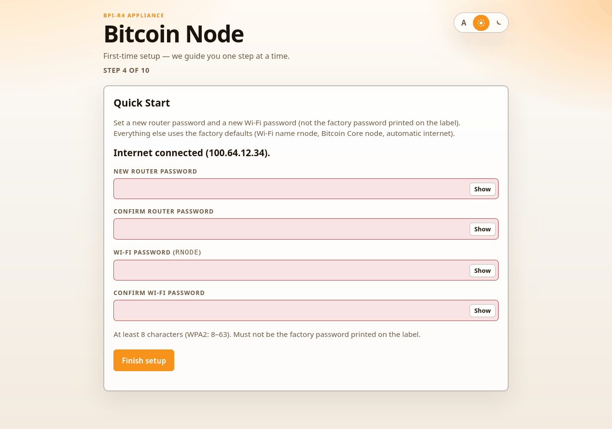

1. **New router password** and **Confirm router password** — at least 8
   characters.
2. **Wi-Fi password (rnode)** and **Confirm Wi-Fi password** — 8 to 63
   characters (letters, numbers and ordinary symbols; no accented letters).
3. Click **Finish setup**.

Rules: neither password may be the one on the label; each pair must match (the
boxes turn green when they do). Spaces count — passwords are used exactly as
typed. Mistakes are shown at the top of the page:

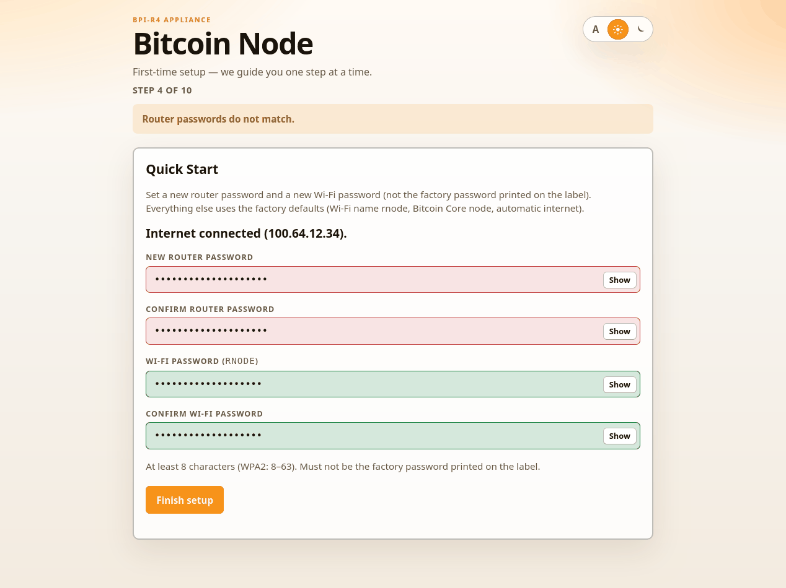

**Internet check.** Opening Quick Start sets the internet to *automatic*
(what most modems need) and checks it. You see *Internet connected* with an
address, or after about 20 seconds:

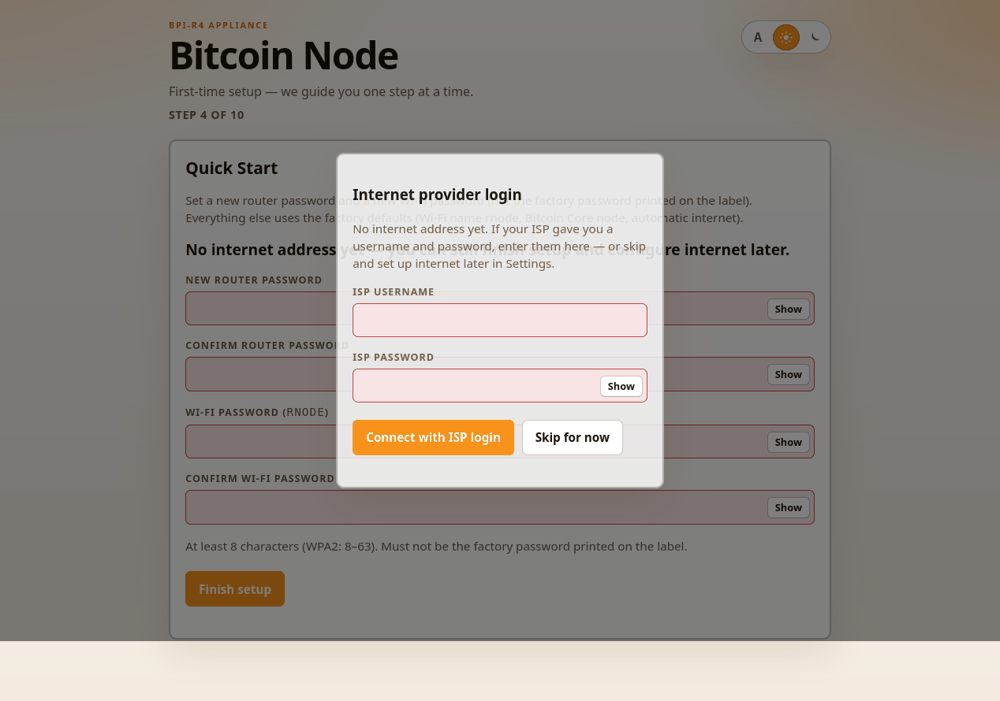

If your provider gave you a **username and password** (PPPoE), type them and
click **Connect with ISP login** — the login is kept when you finish Setup.
Otherwise **Skip for now**: you can finish Setup and sort out the internet
later.

Quick Start keeps the Wi-Fi name **rnode** and the **Bitcoin Core** node. After
**Finish setup**, go to [3.7](#37-finishing-reconnecting-to-the-new-wi-fi).

### 3.6 Guided Setup

#### Step 5 — Bitcoin node

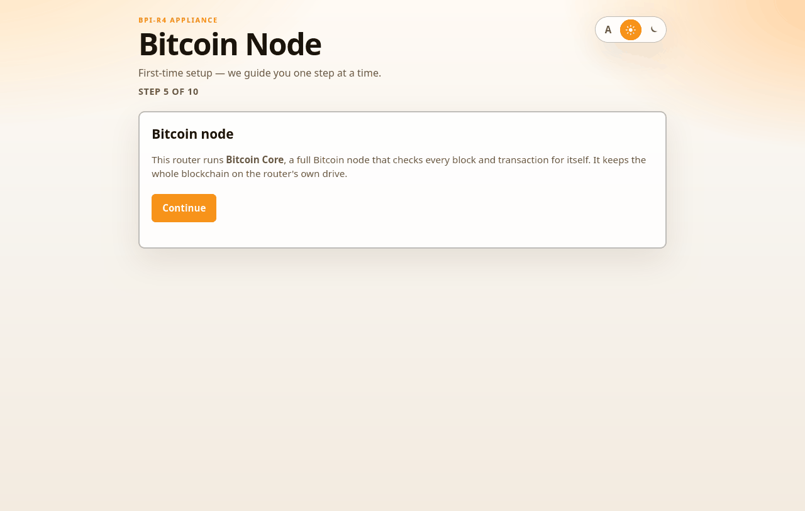

The router runs **Bitcoin Core**. There is nothing to choose; click
**Continue**.

#### Step 6 — Internet

The router tries automatic internet (DHCP) straight away:

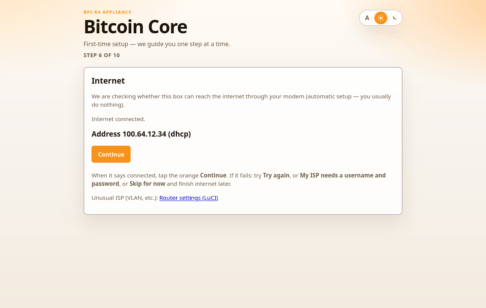

When it says *Internet connected*, click **Continue**. If not:

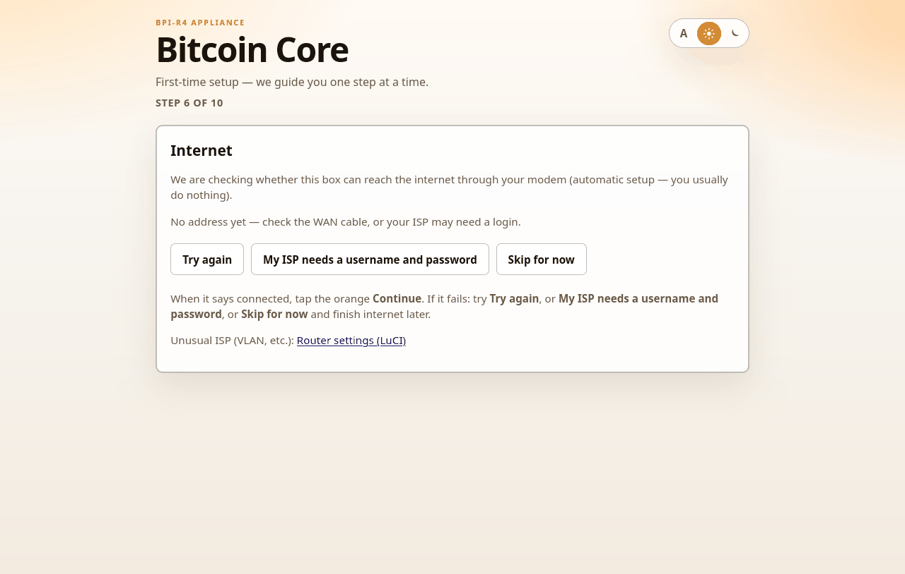

- **Try again** — after checking the WAN cable and the modem.
- **My ISP needs a username and password** — type them exactly as your
  provider gave them and click **Connect with ISP login**:

  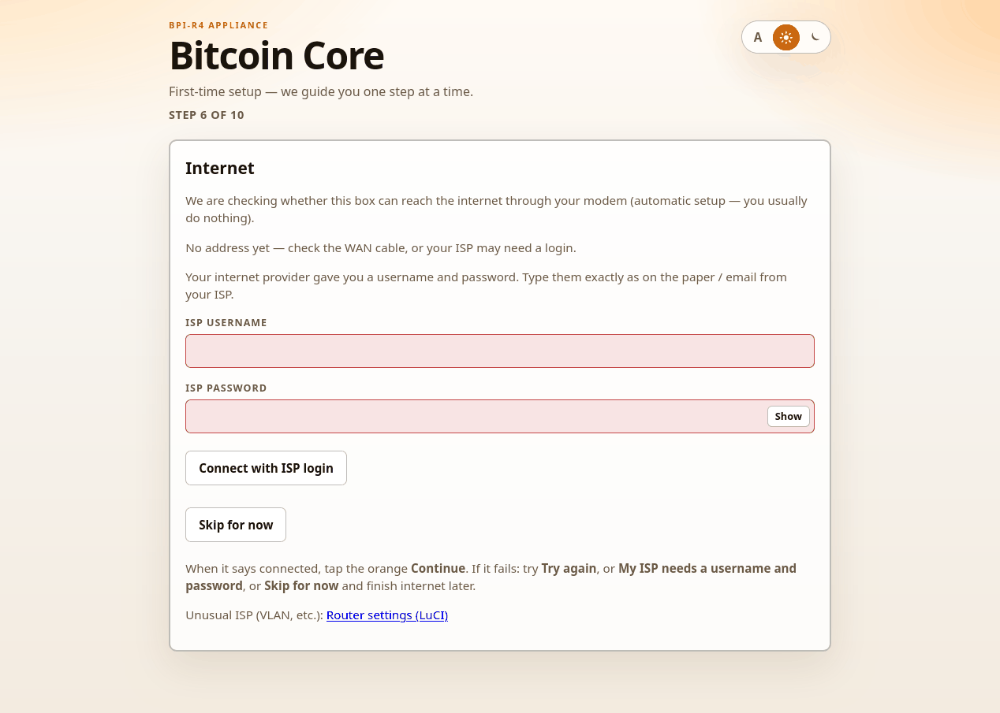

- **Skip for now** — finish Setup and set the internet later.

Unusual connections (VLAN and similar) are set up in **Router settings
(LuCI)** — link on the page.

#### Step 7 — Advanced: LAN address

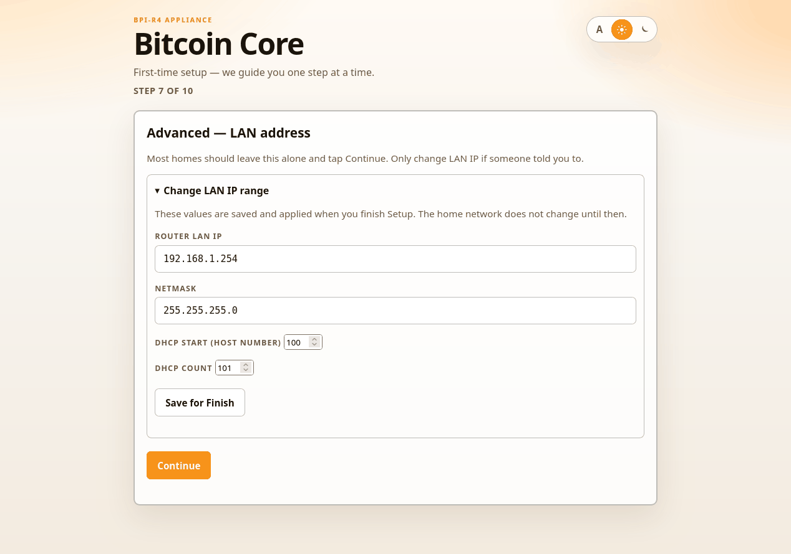

**Most homes leave this alone and click Continue.** Only change it if someone
told you to (for example, your modem also uses `192.168.1.x`).

Under **Change LAN IP range**:

| Field | Default | Rules |
|-------|---------|-------|
| Router LAN IP | `192.168.1.254` | A private address (10.x, 172.16–31.x, 192.168.x) |
| Netmask | `255.255.255.0` | From /16 to /29 |
| DHCP start (host number) | `100` | The pool of addresses handed to devices must fit in the range and must not include the router's own address |
| DHCP count | `101` (devices get .100 – .200) | |

Click **Save for Finish**, then **Continue**. Nothing changes yet — the new
address is applied when Setup finishes.

#### Step 8 — Wi-Fi

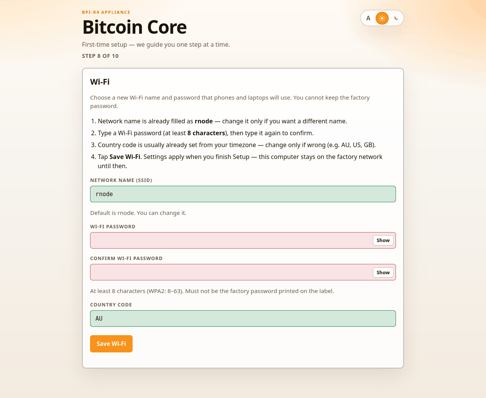

| Field | Rules |
|-------|-------|
| **Network name (SSID)** | `rnode` by default; 1–32 characters |
| **Wi-Fi password** / **Confirm** | 8–63 characters, not the label password |
| **Country code** | Two letters, filled in from your timezone (e.g. `GB`, `US`, `AU`) |

Click **Save Wi-Fi**. Nothing is disconnected: the new Wi-Fi is applied when
Setup finishes — until then you stay connected to `rnode` with the label
password.

#### Step 9 — Router password

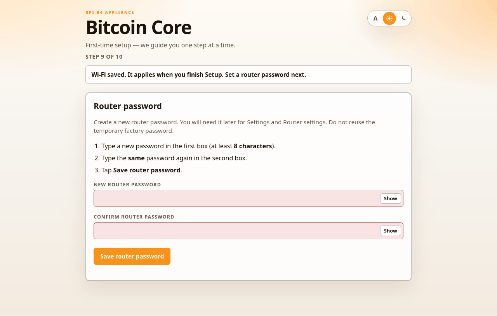

Type the new router password twice (at least 8 characters, not the label
password) and click **Save router password**.

> This takes effect **immediately**: from now on the label password no longer
> logs in to the router. The username stays **root**.

#### Step 10 — You're set

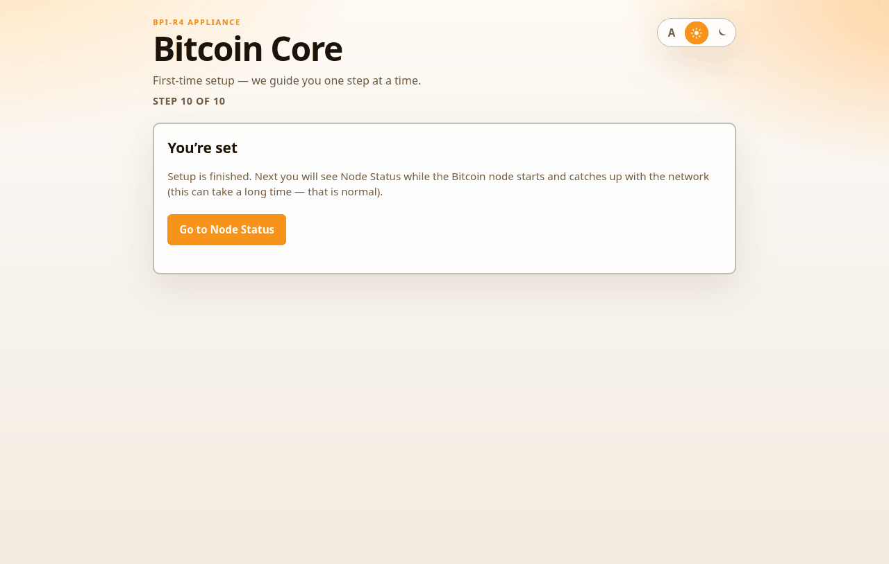

Click **Go to Node Status**. **This button is what finishes Setup** — if you
close the page here, Setup is not finished (see 3.8).

### 3.7 Finishing: reconnecting to the new Wi-Fi

When you finish (Quick Start or Guided), the router applies everything at once.

- **On a cable, with the address unchanged:** Node Status opens straight
  away.
- **On Wi-Fi, or if you changed the address range:** you see *Applying your
  settings*:

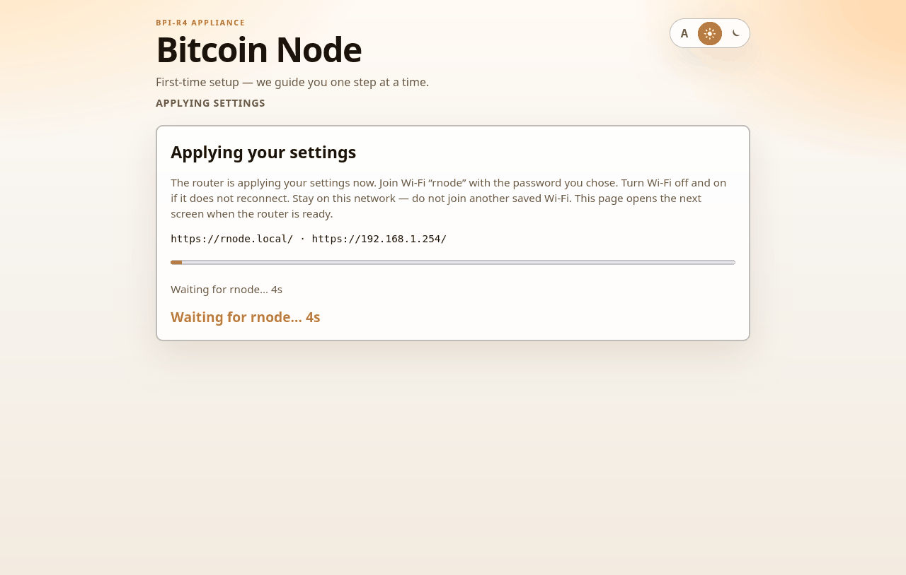

1. Join the Wi-Fi network shown (for example `rnode`) with the **new** Wi-Fi
   password. Turn your computer's Wi-Fi off and on if it does not reconnect.
   Do not join a different saved network.
2. If you changed the address range: turn Wi-Fi off and on, or unplug and
   re-plug the cable, so the computer gets a new address. The old address works
   for about 2 minutes only.
3. Leave the page open. It opens **Node Status** by itself (usually within 3
   minutes). If it is still waiting after 3 minutes it says so and offers a
   link once you are back on the router's network.

After Setup:

- The router password is the one you chose; the username is **root**.
- The label password no longer works (until a factory reset).
- `http://rnode.local/` on a new computer opens **Add this computer** (section
  8).

### 3.8 If Setup is interrupted

| What happened | What to do |
|---------------|------------|
| Browser closed, computer slept | Open the label address again. Setup restarts at Welcome; the Security step notices the certificate is already installed and moves on within seconds. Anything you already saved is kept |
| Power cut or restart **before** finishing | The Wi-Fi is still `rnode` with the label password. Start Setup again. If you had already saved the router password in Guided step 9, that new password is the router password |
| Closed the page on **You're set** | Setup is not finished. Start again; the router password you saved is kept |
| You clicked through a browser certificate warning | Setup skips Welcome and Security and continues at step 3. Install the secure connection later (section 8) |
| You want to run Setup again | Only after a factory reset (section 11) |

---

## 4. Node Status — the main page

Open `https://rnode.local/` (or the router's own name or address). The menu at
the top is on every page:

**Node Status** · **Node software** · **Settings** · **Router settings**

The circle buttons at the top right choose **A**uto, light or dark colours
(saved in this browser only).

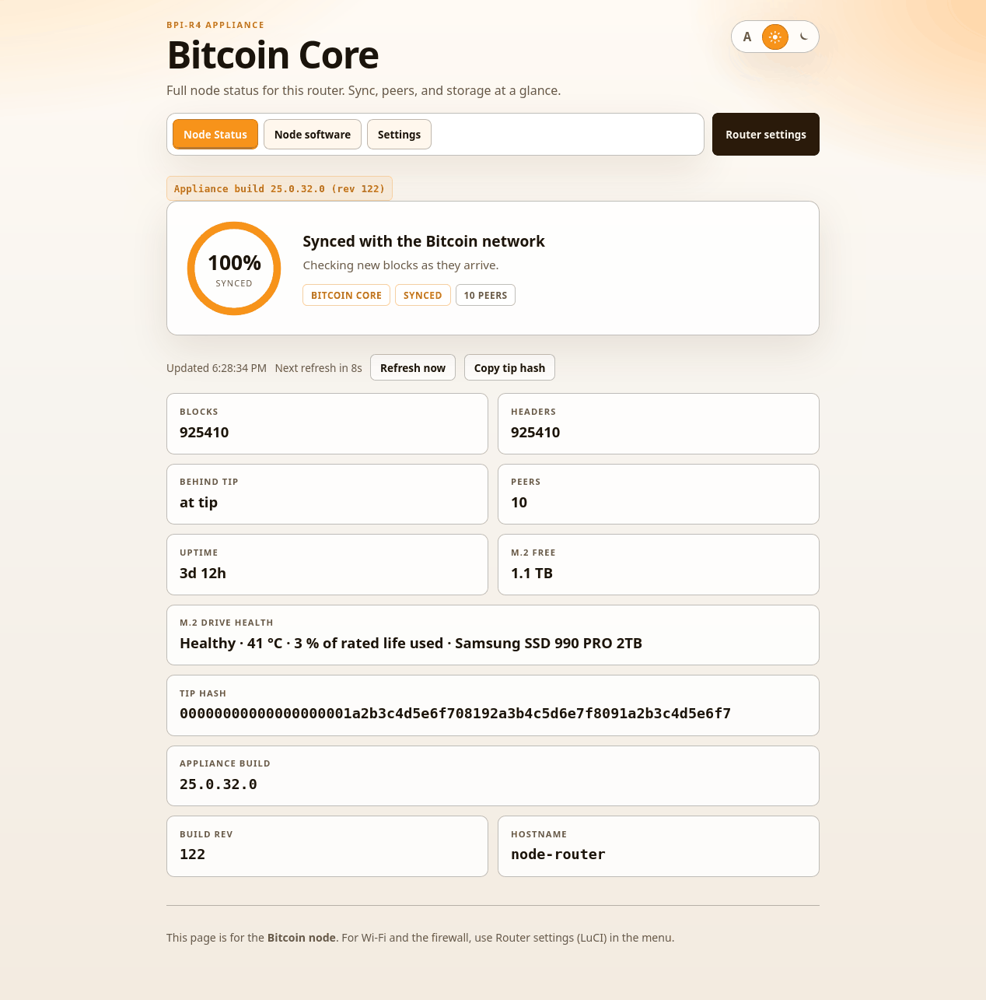

The page refreshes itself every 10 seconds (**Refresh now** to update at once;
**Copy tip hash** copies the latest block's hash).

### The headline

| What it says | What it means | What to do |
|--------------|---------------|------------|
| **Synced with the Bitcoin network** | Up to date; checking new blocks as they arrive | Nothing |
| **Downloading & verifying the blockchain** (with %) | Catching up. The first full sync takes **days** | Leave it on |
| **Node is initialising …** | Starting up, or loading after a power cut | Wait a few minutes |
| **Waiting for the correct time …** | The router has no clock battery and sets the time from the internet | Check the WAN cable; the node starts by itself |
| **Repairing the chain database** | A repair is running, using blocks already on the drive (not a re-download) | Keep the power on; can take many hours |
| **Chain database needs repair** | The node cannot start until the database is rebuilt | See *Repairing the chain database* below |
| **Node not running** + an error | Something stopped the node | See *Error codes* below |

Syncing:

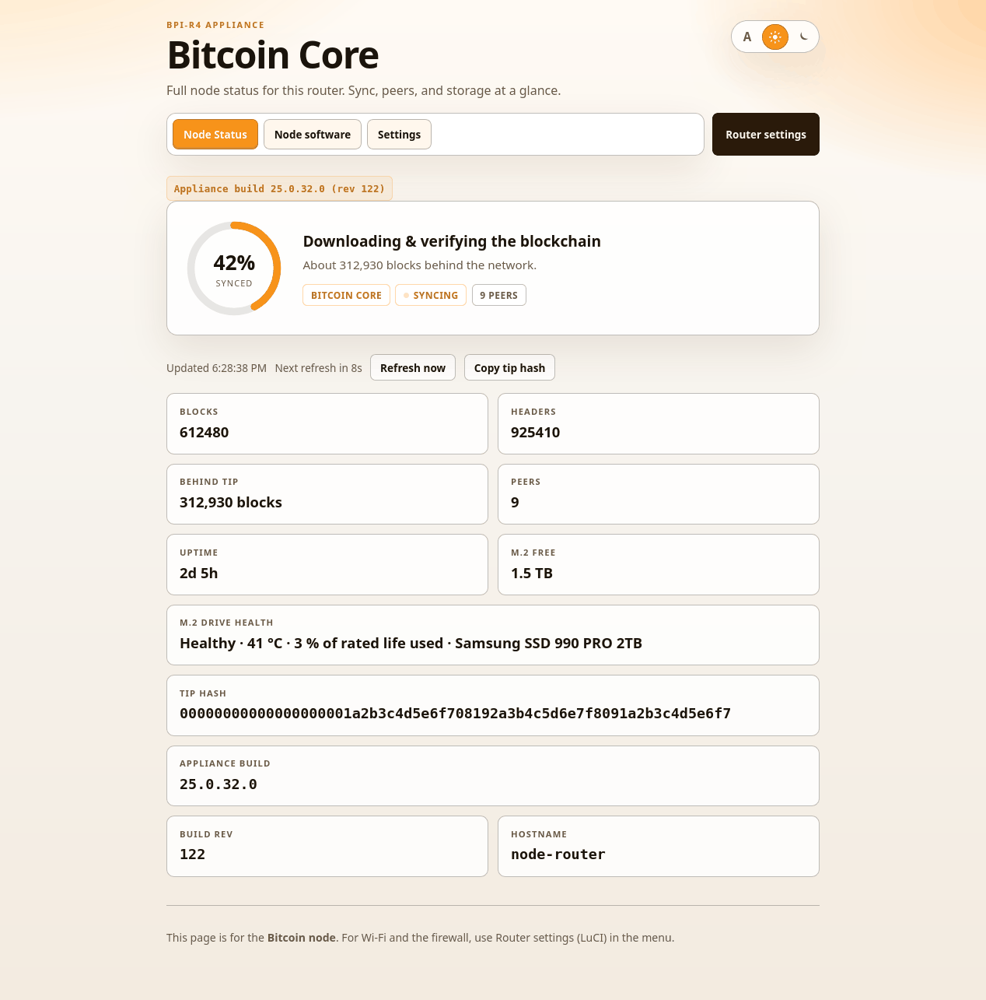

Starting up and waiting for the time:

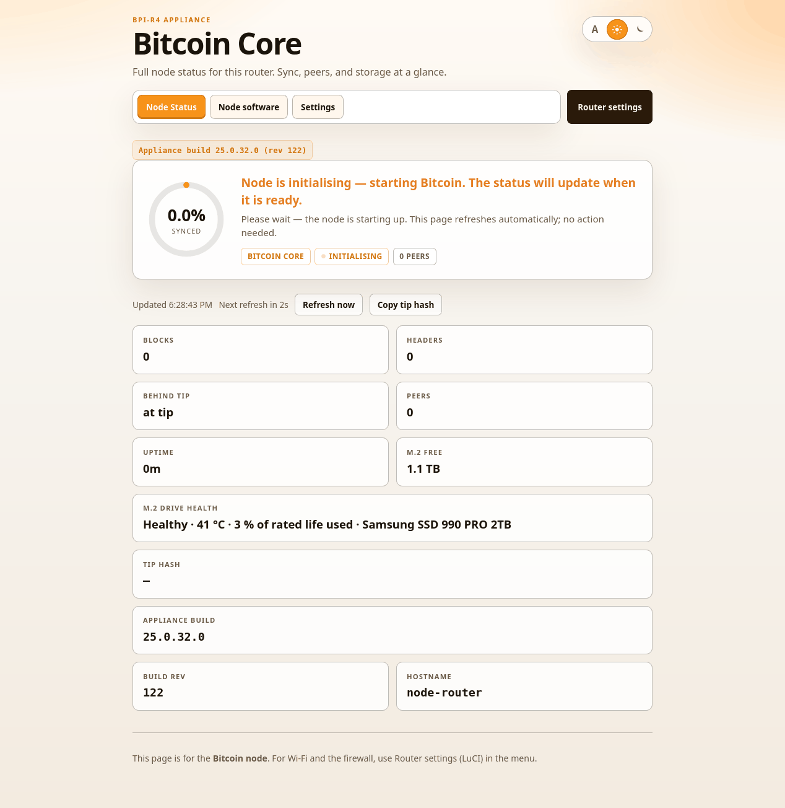

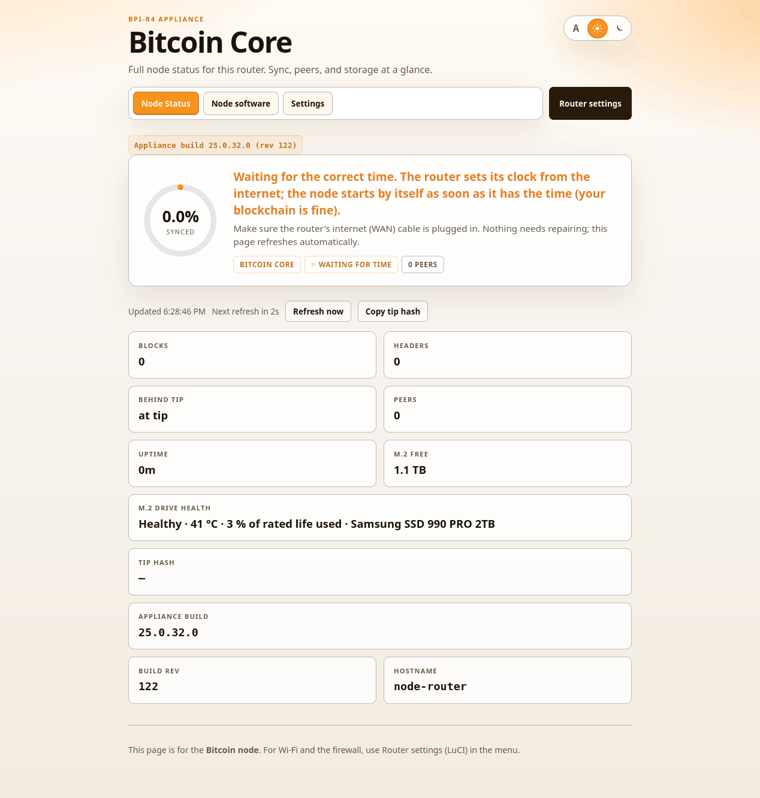

Right after Setup or an update, 0 % or *initialising* for 5–10 minutes is
normal.

### The tiles

| Tile | Shows |
|------|-------|
| Blocks / Headers | Blocks the node has checked / blocks the network has announced |
| Behind tip | How many blocks behind, or **at tip** |
| Peers | Other Bitcoin nodes connected |
| Uptime | How long the **node** has been running (not the router) |
| M.2 free | Free space on the blockchain drive |
| M.2 drive health | Health, temperature, wear and model of the drive |
| Tip hash | The latest block's hash |
| Appliance build / Build rev / Hostname | Firmware version, build number, router name |

### Warnings on the page

**Drive health.** The drive is checked every 5 minutes. Anything other than
*Healthy* shows a banner:

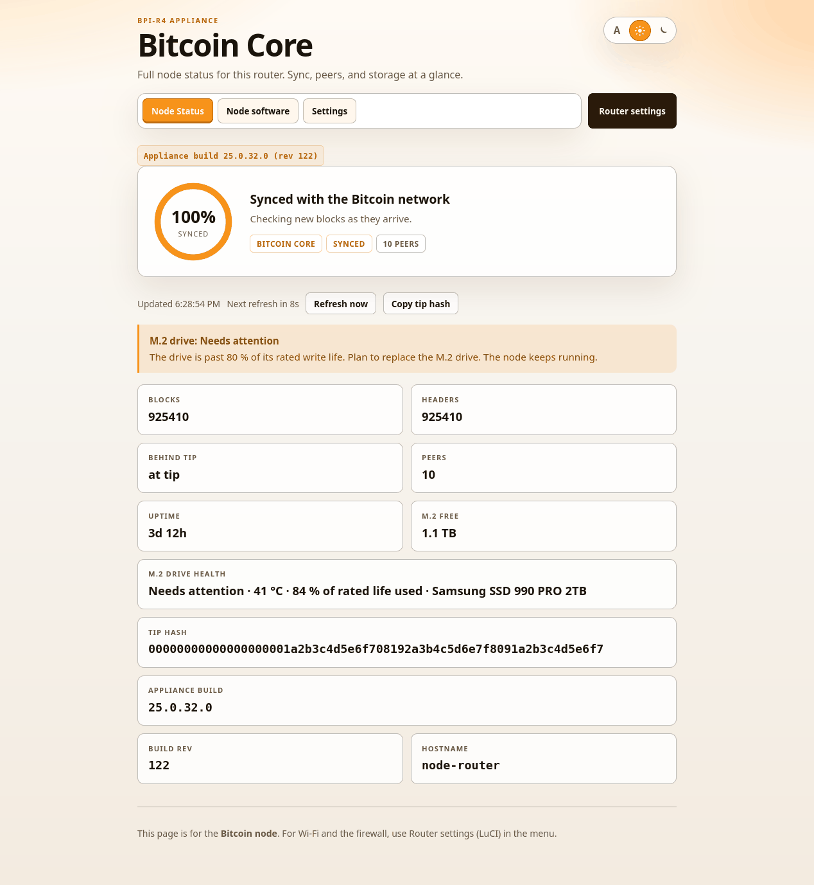

| Level | Meaning |
|-------|---------|
| Healthy | Nothing to do |
| Needs attention | Plan to replace the drive. The node keeps running |
| At risk | Replace the drive soon and contact support |
| Failed | The node cannot use the drive. Contact support |

Reasons include: drive not detected or not responding; switched to read-only;
file-system errors; spare capacity low; past 80 % (or 100 %) of rated write
life; data errors; running hot (about 70 °C) or too hot (about 80 °C — check
airflow).

**Power was lost** — shown for 7 days after the router lost power without
shutting down. A small UPS protects the drive.

**Low free space** — under 100 GB free. The node keeps the whole blockchain
(it never prunes), so plan a bigger drive.

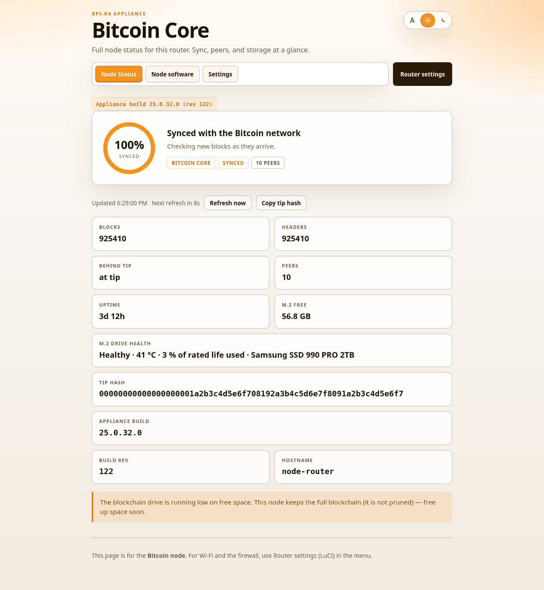

### Repairing the chain database

If the database was damaged (usually by a power cut), the page shows **Chain
database needs repair**:

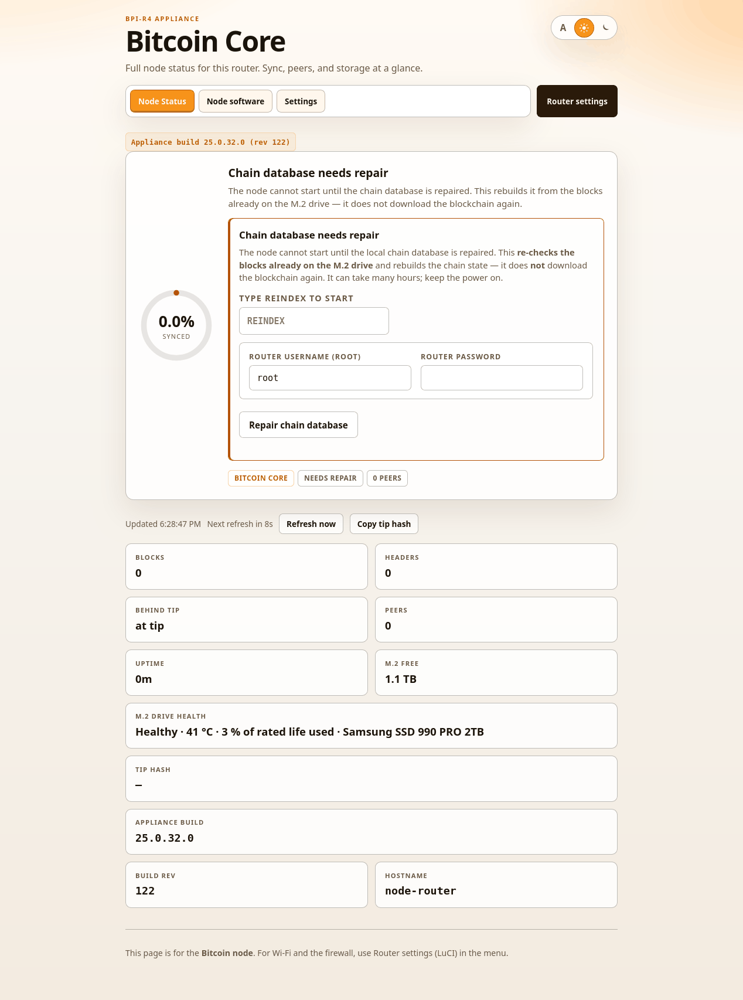

1. Type **REINDEX**.
2. Router username **root** and your router password.
3. Click **Repair chain database**.

It rebuilds from the blocks already on the drive — **nothing is downloaded
again** — but can take many hours. Keep the power on.

### Error codes

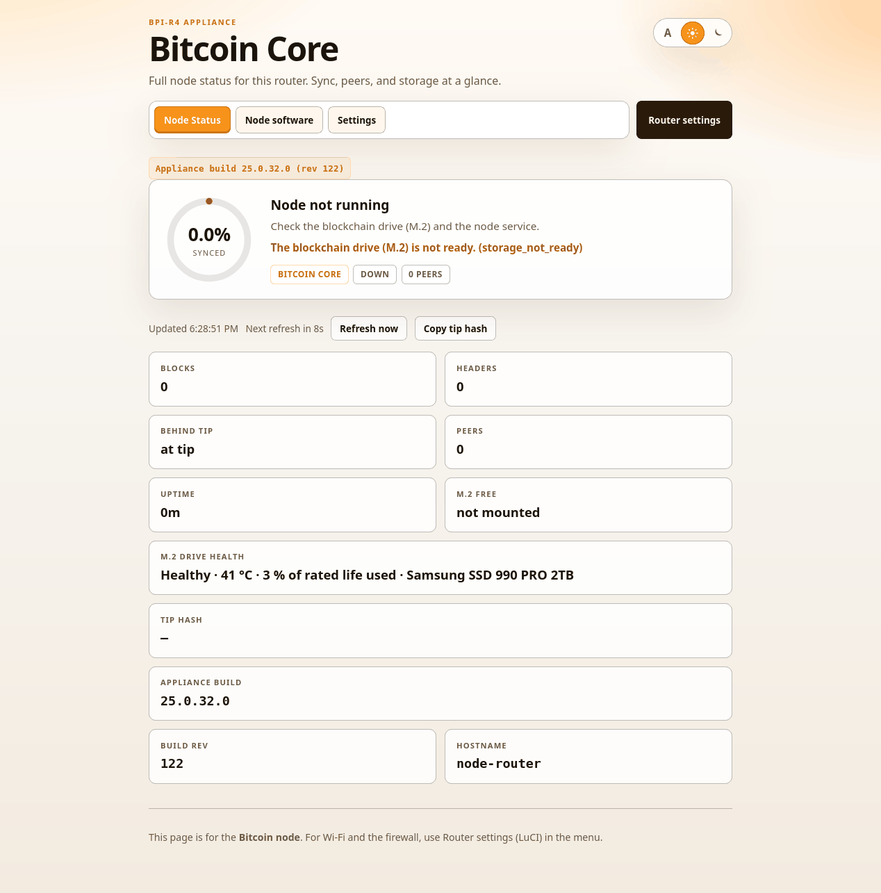

| Error | Meaning | What to do |
|-------|---------|------------|
| `storage_not_ready` | The blockchain drive is missing or cannot be used | Check the drive health tile; contact support |
| `container_start_failed` | The node's software environment did not start | Restart the router (Settings → Reboot) |
| `node_failed_to_become_ready` | The node did not answer within about 6 minutes | Wait, then Settings → Stop node / Start node |
| `rpc_error` | The node answered with an error | As above; contact support if it stays |

Dark colours (same page):

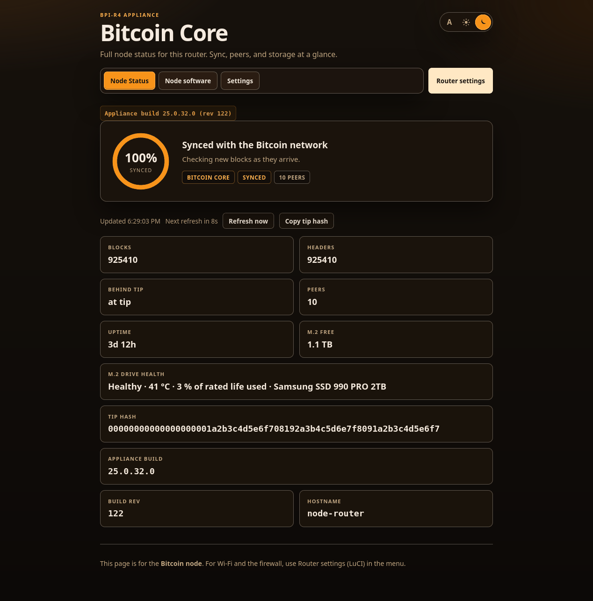

---

## 5. Node software

**Node software** shows which Bitcoin Core is installed (**Installed
version**), whether the node is running, and lets you install a newer official
release yourself, or go back to the previous one.

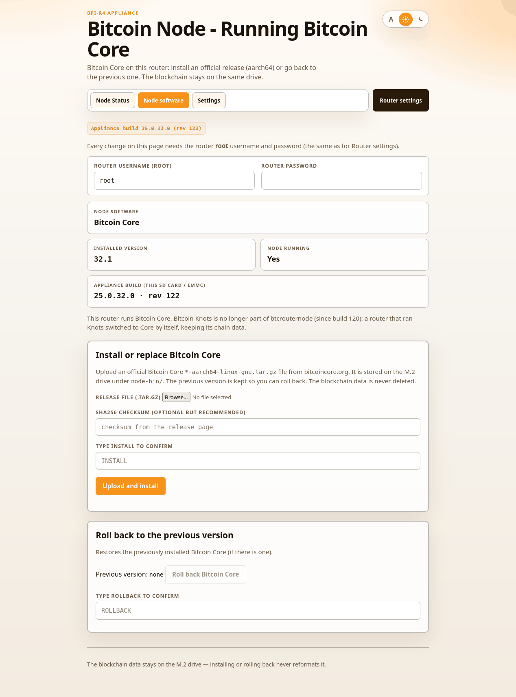

**Install or replace Bitcoin Core**

1. Download the official `bitcoin-<version>-aarch64-linux-gnu.tar.gz` from
   bitcoincore.org (and check it the way that site explains).
2. Choose the file; optionally paste its SHA256.
3. Router username **root**, your router password, type **INSTALL**, click
   **Upload and install**.

The file must be the **aarch64** Linux build (1–120 MB). The previous version
is kept for rollback; the blockchain is not touched; the node restarts.

**Roll back** — type **ROLLBACK** and click **Roll back Bitcoin Core** to
return to the previous version (only if one is kept).

Bitcoin Knots is no longer offered (since build 120); a router that ran Knots
switched to Core by itself, keeping its blockchain.

---

## 6. Settings

`https://rnode.local/settings.html` — the **Settings** menu item.

**How changes work.** There is no login session. Each section has its own
**Router username** (`root`) and **Router password**, plus a word to type
(for example **REBOOT**) — then the browser asks you to confirm. After 10
wrong passwords in a minute, the router refuses for a minute.

Settings works from the router's own network only, never from the internet.
At the top it shows the firmware version and **This router's own address**
(`https://rnode-XXXX.local/`).

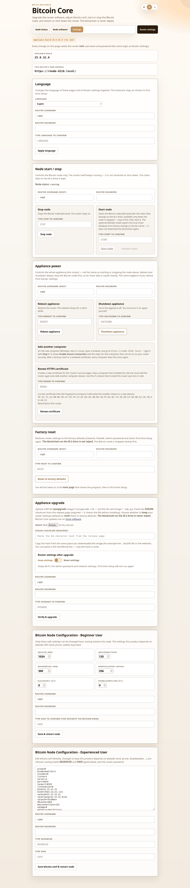

### 6.1 Language

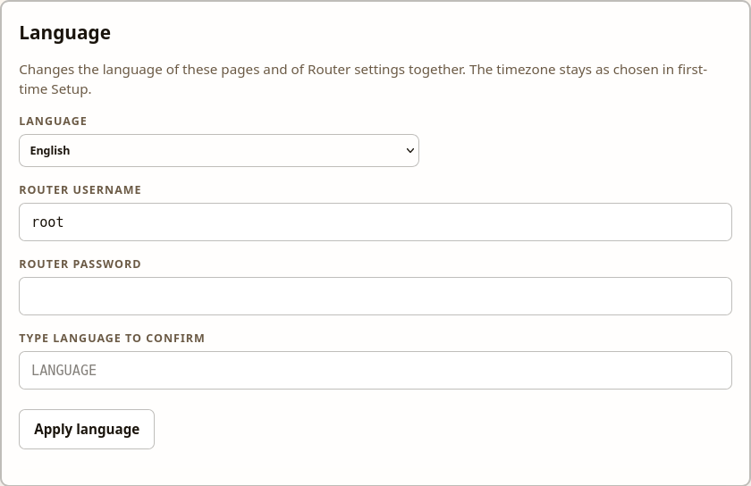

Changes the language of every RNode page **and** Router settings together:
English, Español, Deutsch, Français, 简体中文, 日本語, Português (Brasil).
Type **LANGUAGE**, click **Apply language**. No restart. The timezone stays as
set in Setup (change it in Router settings, section 7).

### 6.2 Node start / stop

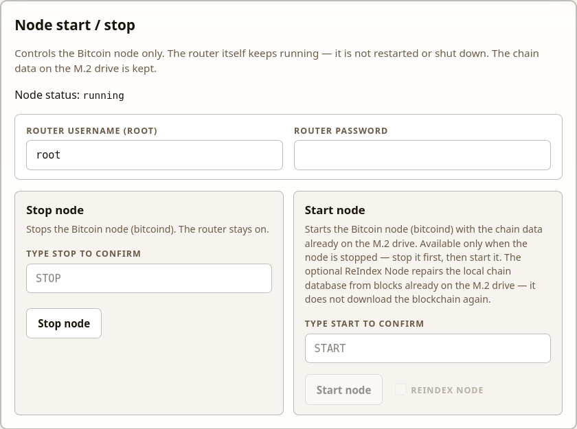

Controls the Bitcoin node only — the router stays on and the blockchain is
kept.

- **Stop node** — type **STOP**. Available while the node runs.
- **Start node** — type **START**. Available while the node is stopped.
  Tick **ReIndex Node** to repair while starting:
  - **Repair chain database** (usual) — rebuilds from blocks on the drive.
  - **Also rebuild the block index** — slower, for worse damage.

  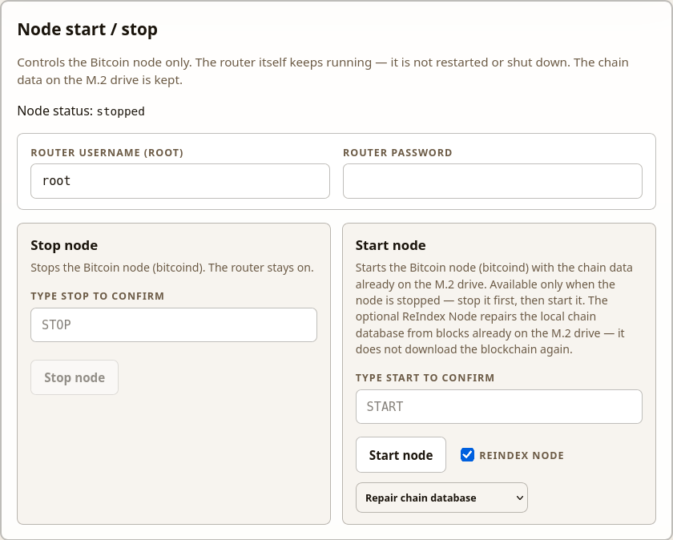

  Both take hours; keep the power on.

### 6.3 Appliance power

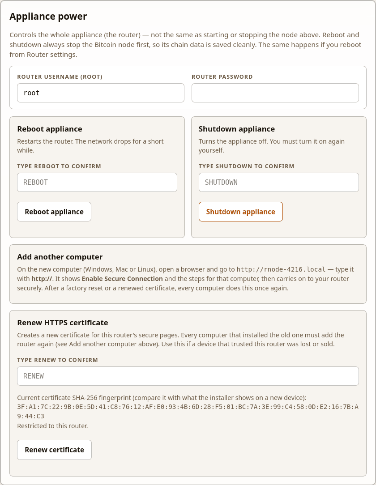

- **Reboot appliance** — type **REBOOT**. The node stops cleanly first; the
  network drops for a few minutes.
- **Shutdown appliance** — type **SHUTDOWN**. The node stops cleanly, then the
  router switches off. Switch it on again at the power.
- **Add another computer** — instructions only (section 8).
- **Renew HTTPS certificate** — type **RENEW**. Makes a new secure-connection
  certificate. **Every computer must install it again.** Use it if a computer
  that trusted the router was lost or sold. Also shows the current
  certificate's fingerprint, to compare with what the installer prints.

### 6.4 Factory reset

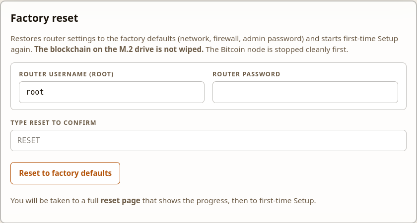

Type **RESET**, click **Reset to factory defaults** — see section 11.

### 6.5 Appliance upgrade

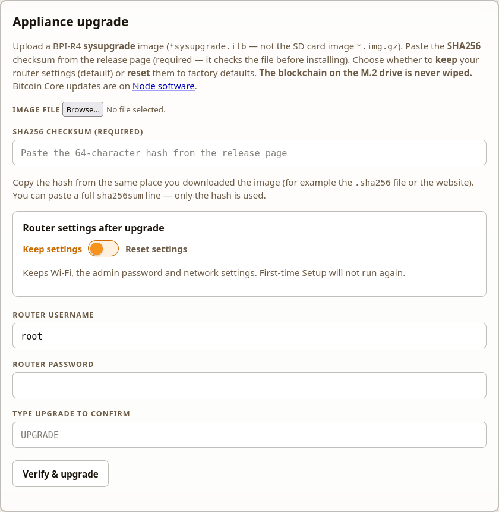

Installs new RNode firmware — see section 9.

### 6.6 Bitcoin node configuration — Beginner

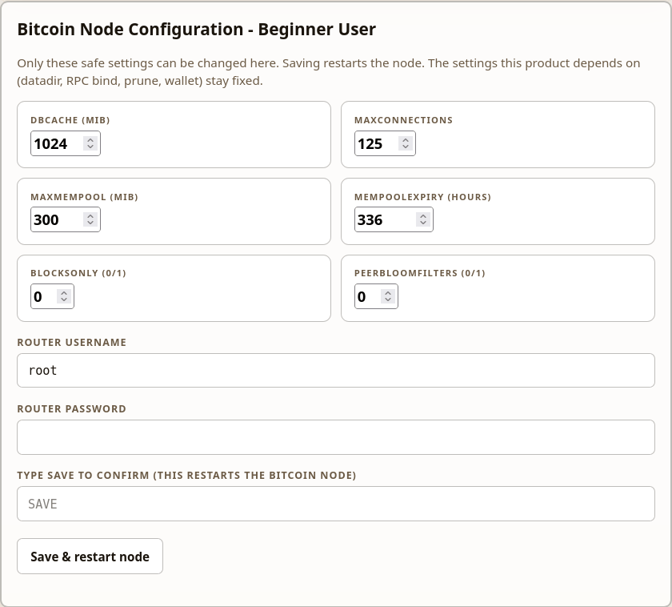

Six safe node settings. Type **SAVE**; the node restarts (the router does
not).

| Setting | Allowed | Default | What it does |
|---------|---------|---------|--------------|
| dbcache (MiB) | 64–2048 | 1024 | Memory for the database. More = faster sync |
| maxconnections | 8–125 | 125 | Most peers the node connects to |
| maxmempool (MiB) | 5–1000 | 300 | Memory for unconfirmed transactions |
| mempoolexpiry (hours) | 1–10080 | 336 | How long unconfirmed transactions are kept |
| blocksonly (0/1) | 0 or 1 | 0 | 1 = do not relay unconfirmed transactions (less data) |
| peerbloomfilters (0/1) | 0 or 1 | 0 | 1 = serve old-style light wallets |

### 6.7 Bitcoin node configuration — Experienced

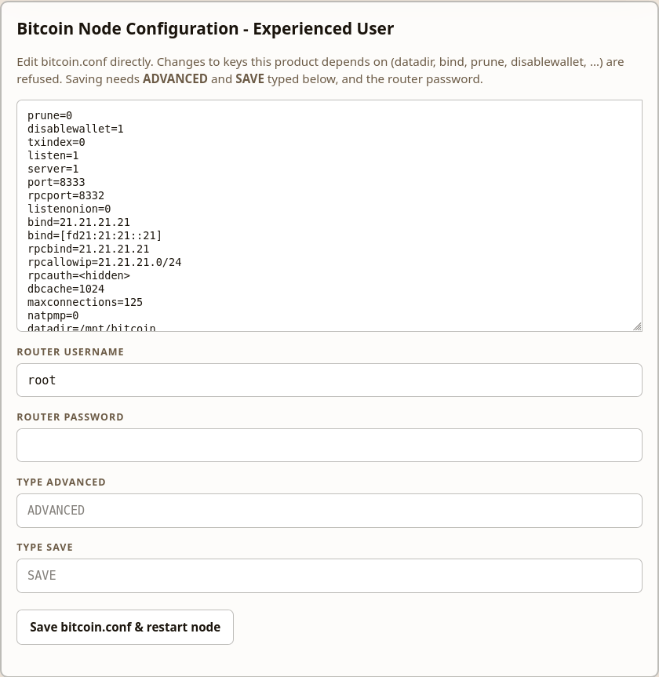

The whole `bitcoin.conf` file. Type **ADVANCED** and **SAVE**; the node
restarts. Passwords in the file are shown as `<hidden>` and kept when you save.

Settings that keep the router safe and working **cannot be changed** (saving
is refused): the data folder, pruning (the node always keeps the full chain),
wallet (disabled), the network and RPC addresses and ports, RPC passwords and
access, Tor/proxy/listening settings, included files and notify scripts.

Your node settings (Beginner and Experienced) are **kept** when you update the
firmware with *Keep settings* and when you do a factory reset. If a new
firmware changes a default you never touched, you get the new default.

> Updating **from 25.0.32.0** is the one exception: that version could not keep
> them, so set them again after that one update.

---

## 7. Changing Wi-Fi, passwords and internet after Setup

These are changed in **Router settings** (OpenWrt's LuCI), not on the
Settings page. Click **Router settings** in the menu (it opens
`https://rnode.local:8443/`), then **Continue to LuCI login**:

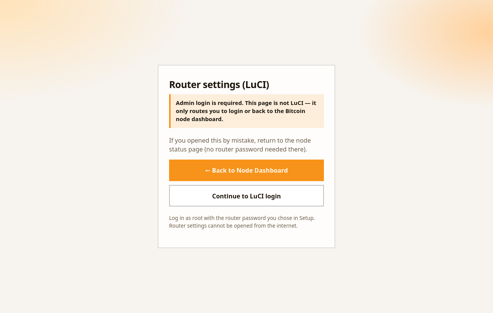

Log in as **root** with your router password. A bar at the top of every page
(**← Node Dashboard**) brings you back. Then:

| To change | In Router settings |
|-----------|--------------------|
| **Wi-Fi password or name** | **Network → Wireless** → **Edit** on each `rnode` network → **Interface Configuration** (name: *ESSID*) and **Wireless Security** (password: *Key*, 8–63 characters) → **Save** → **Save & Apply**. Change both networks (one per radio) the same way |
| **Router password** | **System → Administration** → **Router Password** → type it twice → **Save** (also the password for Settings) |
| **Internet login (PPPoE)** | **Network → Interfaces** → **wan** → **Edit** → *Protocol* **PPPoE** → **Switch protocol** → username and password → **Save** → **Save & Apply** |
| **Timezone** | **System → System** → *Timezone* → **Save & Apply** |

After changing the Wi-Fi, rejoin with the new name or password.

Do not change the **dmz** network, the firewall zones or the port forward for
port 8333 — the node depends on them.

---

## 8. Adding another computer (secure connection)

Each computer you use with the router needs the secure connection once. On the
new computer (on the router's network), open `http://rnode.local/` — typed
with **http://**. The page checks whether this computer is already trusted (if
so, it goes straight to the secure page); otherwise:

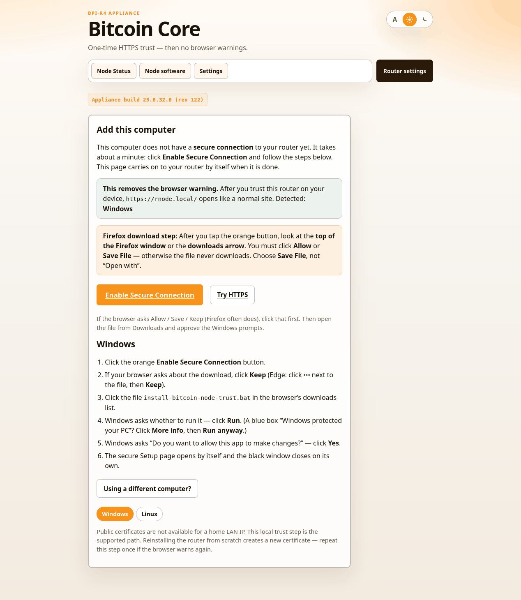

Click **Enable Secure Connection** and follow the same steps as in Setup
([3.3](#33-step-2--security-secure-connection)). Mac and Linux:

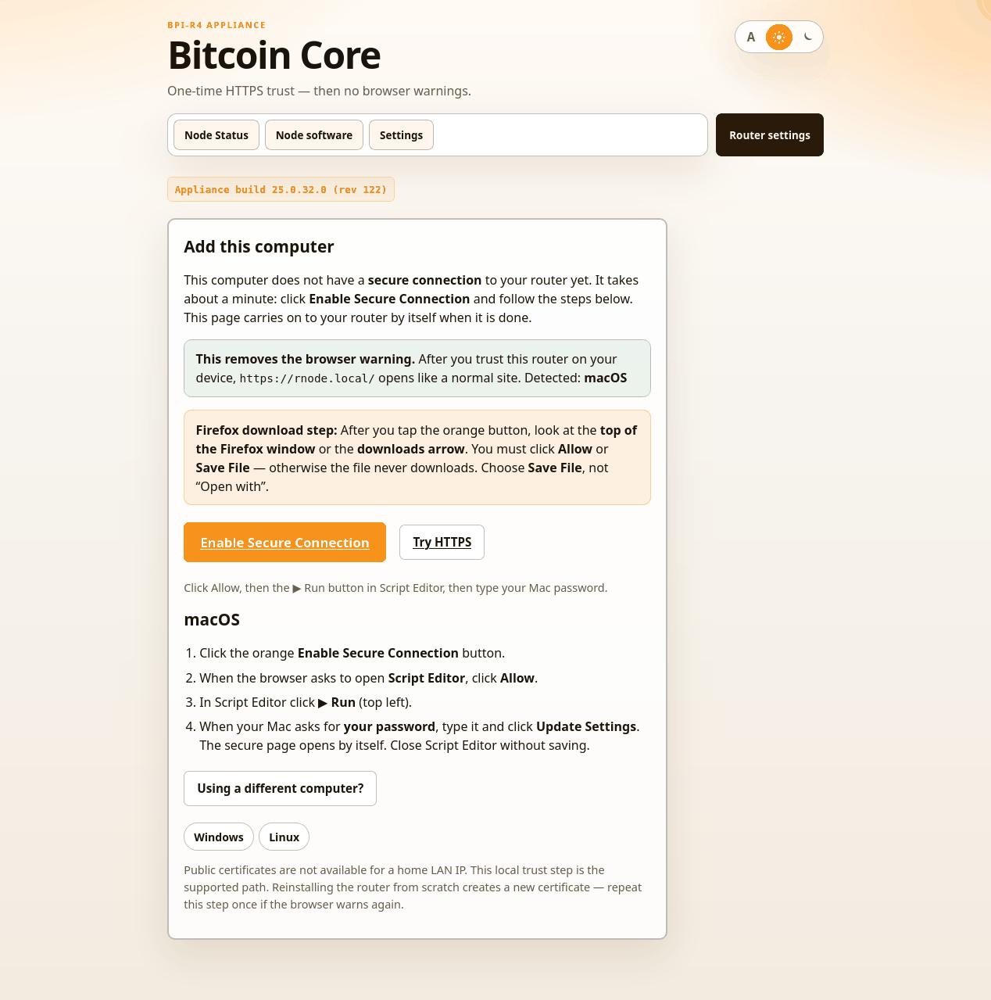

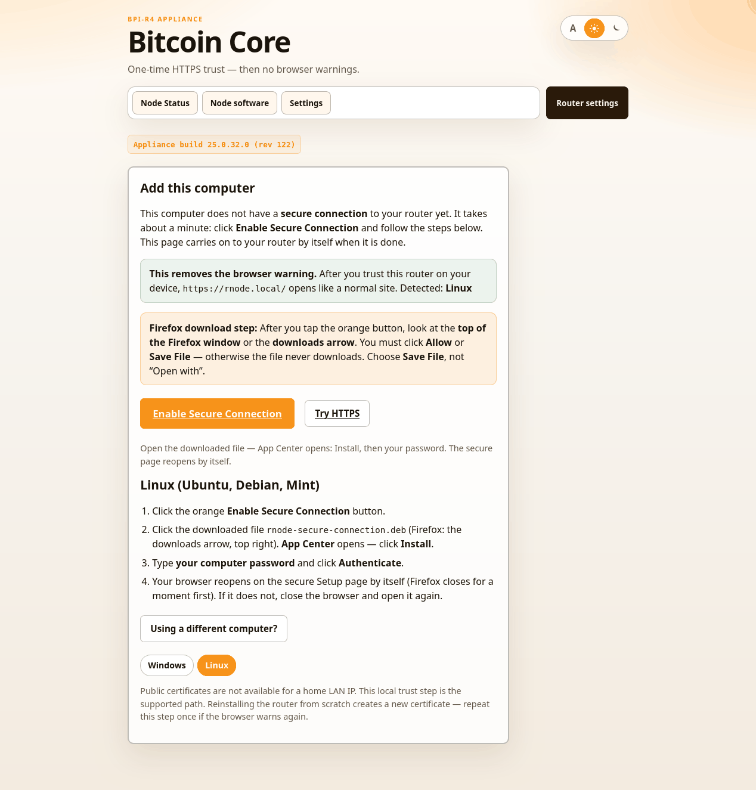

Phones and tablets: not needed and not supported —

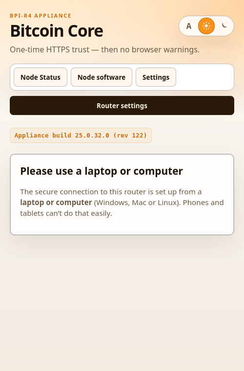

**When computers must do this again:** after a **factory reset**, after
**Renew HTTPS certificate**, and after a firmware update with **Reset
settings** — each makes a new certificate. A normal update keeps it.

**Checking it is really your router:** the installer prints a *fingerprint*.
It must match the one under **Settings → Renew HTTPS certificate** on a
computer that already trusts the router.

On Linux, uninstalling the `rnode-secure-connection` package removes the trust
again.

---

## 9. Updating the firmware

RNode accepts **only official releases signed by the RNode maintainers**. An
update never touches the blockchain.

1. Download the firmware (`bpi-r4-phase2-<version>-squashfs-sysupgrade.itb`)
   and its **SHA256** from the release page.
2. **Settings → Appliance upgrade:**
   - **Image file:** choose the `.itb` (not the SD-card image).
   - **SHA256 checksum:** paste the 64-character value (a whole
     `sha256sum` line is fine).
   - **Router settings after upgrade:** **Keep settings** (normal) or
     **Reset settings** (back to factory defaults; Setup runs again).
   - Router username **root**, router password, type **UPGRADE**, click
     **Verify & upgrade**, confirm.
3. The router checks the file before changing anything, then opens the
   progress page.

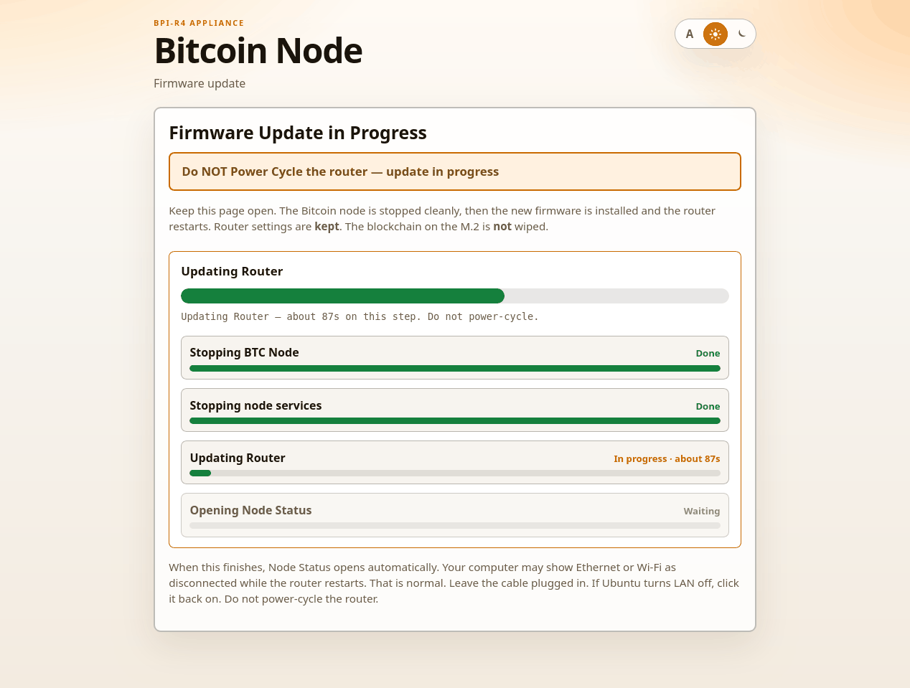

**Do not switch the router off** during the update. Keep the page open. Your
computer may show the network as disconnected while the router restarts —
that is normal; leave the cable in (if Ubuntu switches the wired network off,
switch it back on).

| | Keep settings | Reset settings |
|---|---|---|
| Takes about | 5 minutes | 11 minutes |
| Ends on | Node Status | Setup (Welcome) |
| Wi-Fi, passwords, network, node settings | Kept | Back to the label (node settings kept) |
| Secure connection | Kept | New certificate — every computer installs it again |
| Blockchain | Kept | Kept |

With **Reset settings** the steps end with *Opening Setup*:

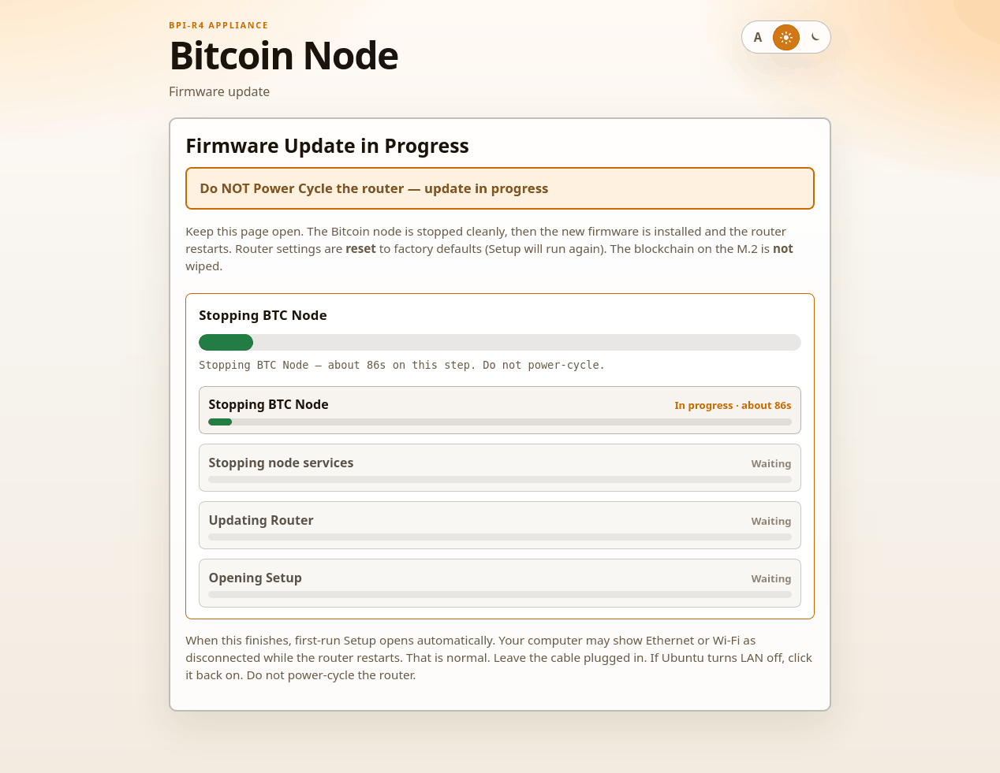

**If it is refused** (nothing is changed):

| Message | Meaning |
|---------|---------|
| *SHA256 does not match* | The download is incomplete or not the file you meant. Download again |
| *This image is not signed* / *signature is not valid* | Not an official release, or modified |
| *That looks like an SD card image* | Choose the `…sysupgrade.itb` file |
| *Image size out of range* | Not a firmware file |
| *Another node operation is running* | Wait a minute and try again |

**If it fails** after starting, the page says **Firmware Update Failed — No
update was applied**; the router keeps the previous firmware:

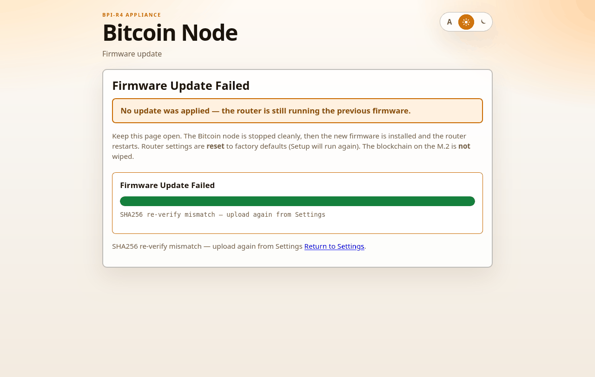

If the router comes back but the page says Node Status needs a trusted secure
connection, click **Open Node Status** (or **Open Setup**); do not switch the
router off.

---

## 10. Restarting, shutting down and power cuts

- **Restart:** Settings → **Reboot appliance**, or a **short press (under 1
  second) of the WPS button**. Restarting from Router settings works the same
  way.
- **Switch off:** Settings → **Shutdown appliance**, then wait about 2
  minutes (the node stops first) before removing power.

Every restart and shutdown — from Settings, Router settings, or the button —
**stops the Bitcoin node cleanly first** so the blockchain is saved safely.

**Power cuts:** the router starts by itself when power returns. The node may
show *initialising — loading and verifying the chain database* for a few
minutes, and *Power was lost* for 7 days. Rarely, a power cut damages the
database and the page asks for a repair (section 4). A small UPS avoids this.

The **RST** button on the board restarts the router **instantly**, without
stopping the node — avoid it.

---

## 11. Factory reset

Puts router settings back to how they were when it arrived. **The blockchain
on the drive is never erased.**

**Three ways:**

1. **Settings → Factory reset** — router password, type **RESET**, click
   **Reset to factory defaults**.
2. **WPS button:** hold it **5 seconds or more**, then let go. Use this if you
   forgot the router password. (A short press only restarts.)
3. Support, on the command line.

It takes about **11 minutes**. Any open RNode page switches to the progress
page; keep it open and do not switch the router off:

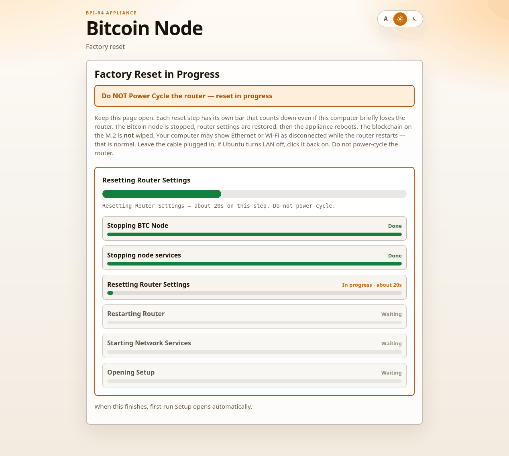

When it finishes, Setup opens at Welcome.

| Back to factory | Kept |
|-----------------|------|
| Router password → the label password | The blockchain and everything on the drive |
| Wi-Fi → `rnode` with the label password | The label password itself (it is built into the router) |
| Router address → `192.168.1.254` | The router's own name `rnode-XXXX` |
| Internet → automatic (ISP login removed) | Node settings in `bitcoin.conf` |
| Timezone → UTC; language → automatic | Installed Bitcoin Core versions |
| Secure connection → **new certificate** (every computer installs it again) | |
| Setup → must be run again | |

---

## 12. Lights and buttons

### Status light (green)

Updated every 15 seconds.

| Light | Meaning |
|-------|---------|
| Slow blink (1 s on, 1 s off) | Starting up, or the node is starting |
| Fast blink | Syncing — catching up with the network |
| Steady | Synced |
| Very fast blink | An update or factory reset is running — do not switch off |
| Off, **blue light blinking** | A problem — usually the blockchain drive. Open Node Status |

### Buttons

| Button | Press | Result |
|--------|-------|--------|
| **WPS** | Short (under 1 s) | Clean restart |
| **WPS** | Hold 5 s or more, then release | Factory reset (section 11) |
| **RST** | Any | Instant hardware restart — node not stopped first. Avoid |

---

## 13. The blockchain drive (M.2)

- The blockchain is kept in full (never pruned). Plan for growth: the page
  warns below 100 GB free.
- A **brand-new, blank** drive is prepared automatically. A drive that already
  has data but cannot be used is **never** erased — the node reports
  `storage_not_ready` and support takes over.
- Nothing on the router can erase the drive — not Settings, not a factory
  reset, not an update.
- The drive is trimmed weekly at night (between 2 and 6 am router time) for
  its health.
- A replacement drive means downloading the blockchain again (several days).

---

## 14. Troubleshooting

**Browser warning ("not secure", "certificate") after a factory reset or a
Reset-settings update.** Normal: the router has a new certificate. Install it
again on each computer (section 8), then restart the browser.

**`rnode.local` does not open.** Use the router's own name from the label
(`rnode-XXXX.local`) or `http://192.168.1.254/`. With two RNodes on one
network, always use the router's own name.

**Setup did not open by itself.** Type the address from the label into a
normal browser, starting with `http://`.

**Forgot the Wi-Fi password.** Connect with a cable and change it in Router
settings (section 7). If you also forgot the router password, do a factory
reset with the WPS button (section 11) and run Setup again.

**Forgot the router password.** Factory reset with the WPS button (hold 5 s).
The label password works again; run Setup.

**Lost the label.** The label password cannot be read from the router.
Contact support with the router's name (`rnode-XXXX`) or MAC address; a new
label with the same password can be made.

**Node Status shows 0 % or an error right after Setup or an update.** Normal
for the first 5–10 minutes. After 30 minutes: Settings → **Stop node**, then
**Start node**. Still wrong — contact support.

**"Waiting for the correct time".** Check the WAN cable and modem. The node
starts by itself once the router has the time.

**The update page says the router cannot be found.** Wait 15 minutes from
starting the update, then open `http://192.168.1.254/`.

---

## 15. Reference

### Addresses and ports

| Item | Value |
|------|-------|
| Router address | `192.168.1.254` (devices get `.100`–`.200`) |
| RNode pages | `https://rnode.local/` (plain `http://` opens the secure-connection page) |
| Router settings (LuCI) | `https://rnode.local:8443/` |
| Bitcoin peer port | 8333, open to the internet so other nodes can connect |
| From the internet | No RNode or Router settings page is reachable |

### What each change affects

| Change | Where | Node restarts | Router restarts | Computers must re-trust |
|--------|-------|:---:|:---:|:---:|
| Language | Setup / Settings | | | |
| Timezone | Setup / Router settings | | | |
| Router password | Setup / Router settings | | | |
| Wi-Fi name / password | Setup / Router settings | | | |
| Internet type / ISP login | Setup / Router settings | | | |
| LAN address range | Guided Setup | | | (no — certificate updated) |
| Node configuration | Settings | ✔ | | |
| Stop / start / repair node | Settings, Node Status | ✔ | | |
| Install / rollback Bitcoin Core | Node software | ✔ | | |
| Renew certificate | Settings | | | ✔ |
| Firmware update — keep settings | Settings | ✔ | ✔ | |
| Firmware update — reset settings | Settings | ✔ | ✔ | ✔ |
| Factory reset | Settings / WPS hold | ✔ | ✔ | ✔ |

### Words to type to confirm

`LANGUAGE` · `STOP` · `START` · `REBOOT` · `SHUTDOWN` · `RENEW` · `RESET` ·
`UPGRADE` · `SAVE` · `ADVANCED` · `REINDEX` · `INSTALL` · `ROLLBACK`

### What changed in 25.1.32.0

- Quick Start keeps an ISP (PPPoE) login typed in its pop-up.
- Guided Setup's Wi-Fi step says correctly that the change applies when Setup
  finishes.
- Node settings (Settings → Bitcoin node configuration) are kept across
  firmware updates.
- A browser timezone missing from Setup's list now selects a matching one and
  says so (instead of always Australia/Sydney).
- Every page is translated into all seven languages.
- The status light keeps blinking very fast for the whole of an update or
  factory reset.
- Screens no longer show internal names or codes.
